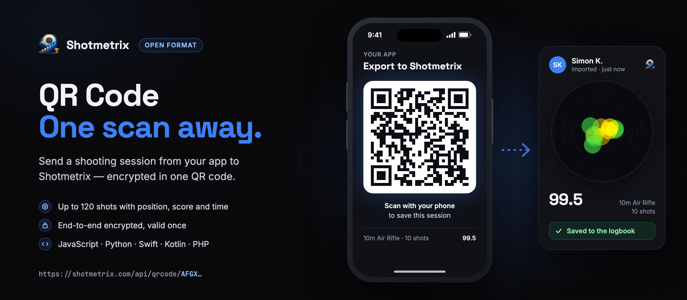
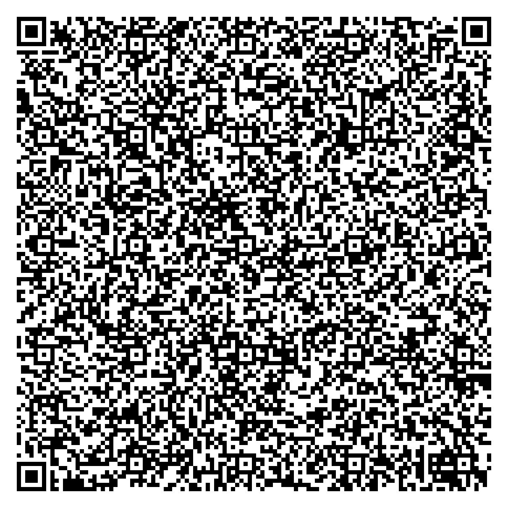

# Shotmetrix QR Code

<p align="center"></p>

Hand a shooting session from your app to [Shotmetrix](https://shotmetrix.com) with one QR code.
The shooter scans it, sees the session on Shotmetrix and saves it to their account. No API key, no
server of your own, no login inside your app.

## What Shotmetrix is

Shotmetrix is a training platform for sport shooters: air rifle and air pistol, small-bore rifle, and
25 m / 50 m pistol. Shooters record their sessions there — from a photo of a paper target, a printout
of an electronic scoring system, a scoring-system QR code, a trainer file, or by hand — and get their
shot pattern, statistics and a training logbook. They can compare themselves with others in
leaderboards, competitions and duels.

Shotmetrix is run by Shotmetrix Kemmer GmbH.

## What this project is

An open format and reference code for one job: **getting shots out of your app and into Shotmetrix.**

Your app builds a URL that contains the session, encrypted for Shotmetrix, and shows it as a QR code.
That is all your app has to do. Everything after the scan happens on Shotmetrix.

```
your app                          shooter's phone                 Shotmetrix
───────────────────────────       ──────────────────────          ──────────────────────────
shots → qrCodeUrl() → QR code →   camera scans the code    →     shows the session,
                                  opens the link                 saves it to the account (once)
```

- **Works offline.** Building the code needs no network. The phone that scans it needs one.
- **One fixed size.** 1 shot or 120: always a version-24 QR code (113 × 113 modules).
- **End-to-end encrypted.** The format is open; the content of each code can only be read by Shotmetrix, and any change makes it invalid.
- **Once.** Every code can be redeemed exactly once.
- **Standard crypto only.** X25519, HKDF-SHA-256 and AES-256-GCM. iOS/macOS, the JVM, browsers, Node.js
  and PHP have them built in; Python uses the widely used `cryptography` package.

## Who it is for

Developers of apps and devices that know where shots landed, for example:

- training and logbook apps for sport shooters,
- apps and software for electronic targets and scoring systems,
- aiming and trigger trainers,
- club and range software that records training results.

You do not need to register to produce codes. Results from codes count for the shooter's own training
on Shotmetrix (statistics, shot pattern, logbook). If you want them to count like results from a
scoring system (leaderboards, competitions, duels), ask Shotmetrix to register your app
([SPEC.md, section 6](SPEC.md#6-registered-apps-optional)).

Shooters themselves need nothing from this repository — they only scan the code.

## What a code carries

- up to 120 shots, each with position (x/y from the centre, in mm), score (decimal or whole rings),
  sighter flag and, optionally, the time of the shot,
- the discipline — one of the 12 disciplines Shotmetrix runs ([disciplines.json](disciplines.json)
  lists them with their targets),
- the start of the session and the total.

## Try it

<p align="center"></p>

Scan this code with your phone camera. It is a real Shotmetrix QR code, built with the Python reference
encoder and the production key: 10 shots of 10m air rifle with shot times, 99.5 in total. Shotmetrix
shows you the session; you do not need an account to see it.

Like every code, it can be saved only once. After someone has saved it to their account, Shotmetrix
says that it has already been redeemed.

## Quick start

```js
import { qrCodeUrl } from './js/shotmetrix-qrcode.mjs';

const url = await qrCodeUrl({
  publicKey: SHOTMETRIX_PUBLIC_KEY,      // keys/shotmetrix-public-key.txt
  discipline: 1,                         // 10m air rifle
  decimal: true,
  time: sessionStart,                    // Date or Unix seconds
  shots: [
    { x: 0.4, y: -1.1, value: 10.6, time: shotTime1 },
    { x: -2.0, y: 0.8, value: 10.1, time: shotTime2 },
  ],
});
// url = https://shotmetrix.com/api/qrcode/AFGX…  → render it as a QR code, error correction L
```

PHP (64-bit, extensions `sodium` and `openssl`):

```php
require 'php/ShotmetrixQRCode.php';

$url = ShotmetrixQRCode::qrCodeUrl([
    'publicKey'  => SHOTMETRIX_PUBLIC_KEY,
    'discipline' => 1,
    'decimal'    => true,
    'time'       => $sessionStart,              // DateTime or Unix seconds
    'shots'      => [
        ['x' => 0.4, 'y' => -1.1, 'value' => 10.6, 'time' => $shotTime1],
        ['x' => -2.0, 'y' => 0.8, 'value' => 10.1, 'time' => $shotTime2],
    ],
]);
```

Python, Swift and Kotlin work the same way. [SPEC.md](SPEC.md) describes every byte, so you can also
write your own encoder and check it against the test vectors.

## Contents

| | |
|---|---|
| Specification | [SPEC.md](SPEC.md) |
| Reference encoders | [JavaScript](js/shotmetrix-qrcode.mjs) · [Python](python/shotmetrix_qrcode.py) · [Swift](swift/ShotmetrixQRCode.swift) · [Kotlin](kotlin/ShotmetrixQRCode.kt) · [PHP](php/ShotmetrixQRCode.php) |
| QR example (Python) | [python/example.py](python/example.py) |
| Test vectors | [test-vectors/](test-vectors/) |
| Disciplines and targets | [disciplines.json](disciplines.json) |
| Public key | [keys/](keys/) |
| Deutsch | [README.de.md](README.de.md) |

All five reference encoders reproduce the test vectors bit for bit. They check every rule in
[SPEC.md, section 7](SPEC.md#7-rules-a-code-must-follow) and refuse faulty input with an English error
message (`shot 3: value out of range`) instead of building a code that Shotmetrix would reject.

## Tested with

Each reference encoder was checked against the test vectors (bit for bit, including every faulty input) with:

| Encoder | Tested with |
|---|---|
| JavaScript | Node.js 20.20 and 26.4, Chrome 155 |
| Python | Python 3.14 with `cryptography` 48 |
| Swift | Swift 6.3 on macOS 26 (CryptoKit) |
| PHP | PHP 8.3 and 8.5 |
| Kotlin | Kotlin 2.1 on JDK 21 |

Android, other browsers and older versions of these runtimes are not tested. If you run the checks in
[SPEC.md, section 8](SPEC.md#8-testing) on another platform, they tell you whether your setup produces the right codes.

## License

Copyright 2026 Shotmetrix Kemmer GmbH. Licensed under the [Apache License 2.0](LICENSE).

The code is provided "as is", without warranty of any kind (sections 7 and 8 of the license). The
license does not grant use of the name "Shotmetrix" beyond saying that your app produces Shotmetrix
QR codes ([NOTICE](NOTICE)).
